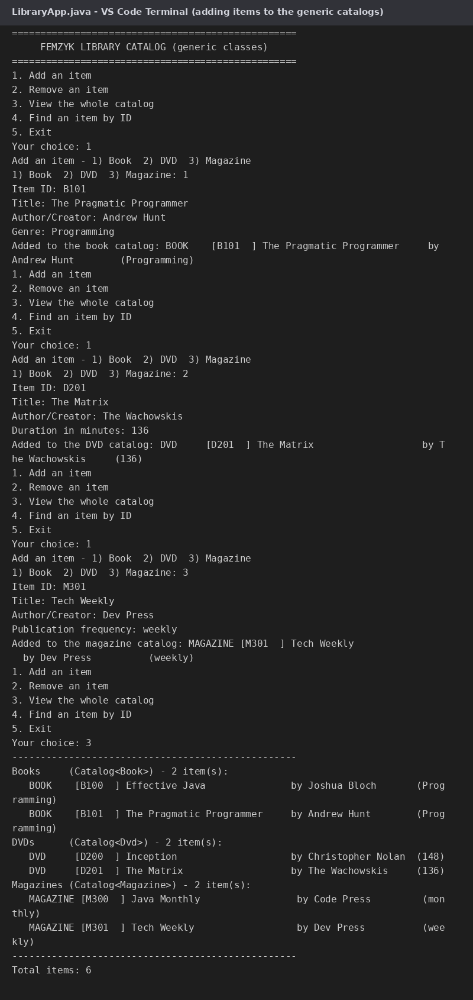
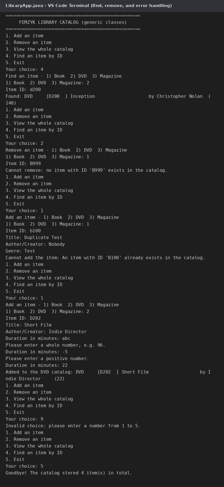

# FEMZYK Library Catalog

A **generic library catalog** built for *CS 1103-01 – Programming Assignment Unit 6*:
one generic `Catalog<T>` class manages books, DVDs, and magazines, driven by an
interactive **command-line interface** and covered by **JUnit 5 tests**.

🔗 **Repository:** https://github.com/FEMZYKENTLTD/FEMZYK-LibraryCatalog

## 🧬 The generics at the core

| Generic piece | What it does |
|---------------|--------------|
| `LibraryItem<T>` | The shared base class (title, author, itemID) with a **type parameter for the details payload** — `Book` uses `LibraryItem<String>` (genre), `Dvd` uses `LibraryItem<Integer>` (minutes) |
| `Catalog<T extends LibraryItem<?>>` | **One catalog class** for every item type: type-safe storage (`Map<String, T>`), add / remove / find / list, bounded so it can use any item's shared operations |
| `LibraryException` | Checked exception for expected failures (duplicate ID, missing item) so callers handle them explicitly |

`Catalog<Book>`, `Catalog<Dvd>` and `Catalog<Magazine>` are three type-safe
instantiations of the **same written-once class** — no casts, no duplication.

## 📁 Project layout

```
FEMZYK-LibraryCatalog/
├── pom.xml                                            Maven build file (JUnit 5 + Surefire)
├── docs/                                              Screenshots used by this README
└── src
    ├── main/java/com/femzyk/library
    │   ├── core/LibraryItem.java                      Generic item base class <T>
    │   ├── core/Book.java, Dvd.java, Magazine.java    Concrete items with different detail types
    │   ├── core/Catalog.java                          Generic catalog: add, remove, find, list
    │   ├── core/LibraryException.java                 Checked exception for expected failures
    │   └── console/LibraryApp.java                    Interactive command-line interface
    └── test/java/com/femzyk/library/core
        └── CatalogTest.java                           8 JUnit tests across two item types
```

## ✅ Requirements

- **JDK 17 or newer** (built and tested on JDK 25)
- **Maven 3.8+**
- VS Code users: the **Extension Pack for Java** extension

## 🚀 Build, test, and run

```bash
# 1. compile, run the 8 JUnit tests, and package (clean: no errors, no warnings)
mvn clean package

# 2. start the interactive catalog
java -cp target/femzyk-library-catalog-1.0.0.jar com.femzyk.library.console.LibraryApp
```

In VS Code: open the folder with the **Extension Pack for Java** installed, then run
`LibraryApp.java` with **F5** (the integrated terminal handles the interactive menu).

## 🧪 The test suite (`mvn test`)

8 tests, all passing — covering both item types with the same suite:

| Test | Scenario |
|------|----------|
| addAndFindBook | Create + case-insensitive lookup |
| duplicateAddThrows | Adding an existing ID throws `LibraryException` |
| removeExisting | Removing returns the item and shrinks the catalog |
| removeNonExistingThrows | Removing a missing ID throws with a clear message |
| catalogWorksWithDifferentTypes | The same class stores `Dvd` (Integer details) too |
| getAllIsSorted | Listing is ordered by ID |
| itemValidation | Constructors reject empty fields and null details |
| findIsCaseInsensitive | `b7` and `B7` find the same item |

## 🖼 Sample session



The CLI validates every input (re-prompting on bad data), reports duplicates and
missing items gracefully, and lists the whole catalog grouped by type:



## 📚 Reading

- Eck, D. J. (2022). *Introduction to programming using Java: Version 9, JavaFX edition* — Chapter 10, especially Section 10.5 "Writing Generic Classes and Methods": https://math.hws.edu/javanotes/c10/
- Divertitto, A. (2022, August 18). *Java generics: how to use angled brackets in practice*. CodeGym: https://codegym.cc/groups/posts/generics-in-java

## Academic context

Course project for **CS 1103-01 – AY2027-T1, Programming Assignment Unit 6**
(University of the People). Built with Maven; compiled with a clean `BUILD SUCCESS`
and `Tests run: 8, Failures: 0, Errors: 0`.
